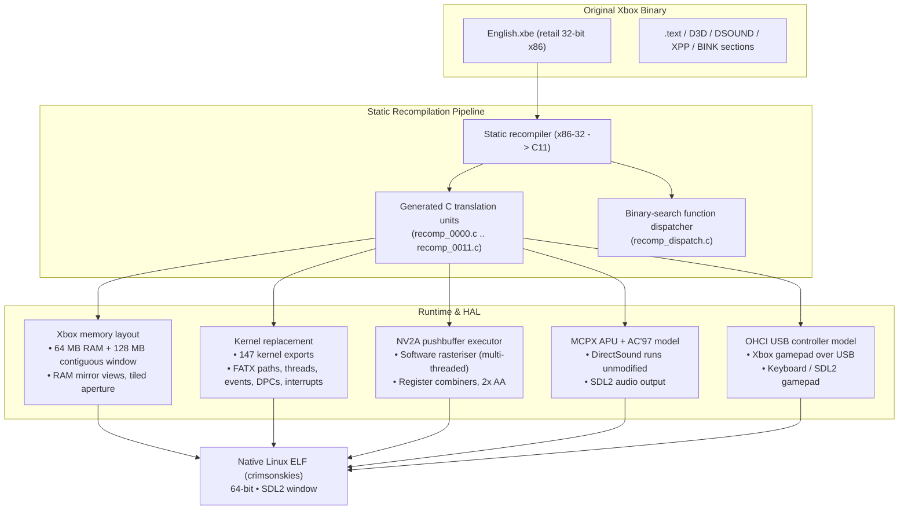
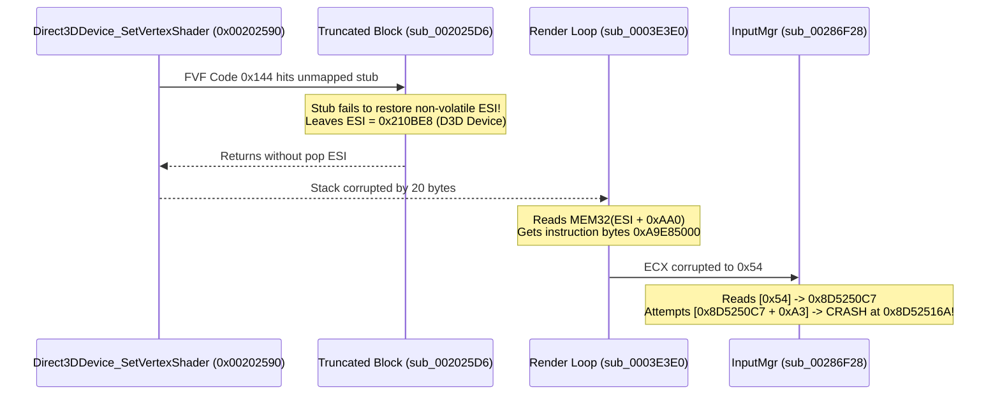

# Crimson Skies: High Road to Revenge — Static Recompilation (Native PC Port)

[](#platform-status)
[](#)
[](#)
[](https://github.com/saironbusatto/CrimsonSkiesRecomp/releases/latest)
[](LICENSE)

A native PC static recompilation of the 2003 Original Xbox game **Crimson Skies: High Road to Revenge** (Title ID `0x4D530021`, entry point `0x001C7CA9`).

Emulators such as xemu or Cxbx-Reloaded interpret or JIT-compile the game's machine code while it runs. This project does it ahead of time instead: it lifts the retail Xbox x86-32 executable into C11 once. That C code is compiled together with a replacement Xbox kernel and models of the Xbox hardware (the NV2A GPU, the MCPX audio processor, the USB controllers) into an ordinary 64-bit program.

**No game files are included.** You need your own legally dumped copy of the game.

---

## Platform Status

| Platform | Status (v1.1.0) |
| :--- | :--- |
| **Linux x86-64** | **Playable.** Full intro, title screen, attract mode, menus with keyboard or gamepad. |
| **Windows x86-64** | **Not working yet.** It builds, but it stops early in boot and shows a black screen. Tracked as a GitHub issue; no Windows binary is shipped in v1.1.0. |

### What works (Linux)
- Boots straight into the game: the Microsoft Game Studios and FASA logos, the intro movie, the 3D title screen and the attract loop.
- Bink movies play with sound and can be skipped with **Start** (Enter).
- Menus respond to the keyboard and to a USB/Xbox-style gamepad.
- Runs for long sessions (4+ minutes of attract loop) without crashing.
- 2x anti-aliased output is shown in a resizable window with smooth scaling.

### Known issues
- **Speed:** graphics are drawn by a software NV2A rasteriser on the CPU. Expect about 22–30 fps on a modern desktop CPU, lower on laptops. A GPU backend is planned.
- **Audio** can stutter when the frame rate drops.
- **Rare crash when pressing a key in the window** (`SIGSEGV` in the USB input path, `sub_00289AE0`). Seen only with real keypresses, not reproduced with scripted input. If it happens, just restart.
- A second **"PRESS START"** is drawn at the bottom-left of the title screen.
- Gameplay past the menus has not been tested much yet.

---

## Quick Start (Linux)

1. Install the runtime libraries:
   ```bash
   # Debian / Ubuntu
   sudo apt install -y libsdl2-2.0-0 libepoxy0
   # Fedora / Nobara
   sudo dnf install -y SDL2 libepoxy
   ```
2. Copy your game dump (the folder with `English.xbe` or `default.xbe`, the `.zip` archives and the `bink1`/`bink2` folders) somewhere on disk.
3. Extract the release archive and run the game from the game folder:
   ```bash
   cd /path/to/crimson-skies
   /path/to/crimsonskies English.xbe .
   ```
   Or copy `crimsonskies` into the game folder and run `./crimsonskies`.

A window opens. The first launch creates the game's cache and save data under `~/.local/share/xboxrecomp/`; later launches start faster.

### Keyboard controls

Click the window first so it has keyboard focus. A connected gamepad works at the same time.

| Key | Xbox controller |
| :--- | :--- |
| **Enter** | Start (skip movies, PRESS START, pause) |
| **Backspace** | Back |
| **Arrow keys** | D-pad (menu navigation) |
| **Z / X / C / V** | A / B / X / Y |
| **W A S D** (or keypad 8 4 2 6) | Left stick |
| **I J K L** | Right stick |
| **1 / 3** | Left / right trigger |
| **Q / E** | White / Black |
| **Shift / Ctrl** | Left / right stick click |

### Gamepad controls (in flight)

| Xbox Gamepad | Flight Action |
| :--- | :--- |
| **Left Stick** | Pitch & Roll |
| **Right Stick** | Free look / camera |
| **Right Trigger** | Machine guns |
| **Left Trigger** | Secondary weapon |
| **A** | Stunt / action |
| **B** | Air brakes |
| **X** | Cycle target |
| **Y** | Cycle secondary weapon |
| **D-Pad Up / Down** | Boost / cut throttle |
| **Start** | Pause menu |
| **Back** | Objectives |

### Options

The game starts with sensible defaults. These environment variables change them:

| Variable | Effect |
| :--- | :--- |
| `RECOMP_DEFAULTS=0` | Do not turn on the default options below (for debugging). |
| `RECOMP_FB_WINDOW=1` | Show the game window (default on). |
| `RECOMP_HEADLESS=1` | Run without a window. |
| `RECOMP_KEYBOARD=1` | Keyboard acts as controller 1 (default on). |
| `RECOMP_WINDOW_NEAREST=1` | Sharp pixel scaling instead of smooth scaling. |
| `RECOMP_AUDIO_BUF_SAMPLES=1024 RECOMP_AUDIO_BUF_COUNT=8` | Larger audio queue; can reduce stutter at the cost of latency. |
| `RECOMP_RASTER_THREADS=N` | Number of CPU threads used to draw (default: CPU count − 4). |
| `RECOMP_SAVE_DIR=/path` | Where saves and the title cache are kept. |
| `RECOMP_STUB_LOG=1` | Log calls into functions that have not been recompiled yet (useful for bug reports). |

The defaults are `RECOMP_USB=1 RECOMP_AC97_READY=1 RECOMP_VBLANK=paced RECOMP_TITLE_KEVENTS=1 RECOMP_PB_EXEC=1 RECOMP_FB_WINDOW=1 RECOMP_KEYBOARD=1`. Setting any of them yourself overrides that one.

---

## Architecture Overview



The game's own Direct3D, DirectSound, Bink and XInput libraries are recompiled like the rest of the game and talk to the hardware models; they are not replaced by PC APIs.

---

## What's New in v1.1.0

v1.0.0 booted but showed only a black screen (issue #11). v1.1.0 makes the game render, play sound and take input:

- **Rendering:** the game's real Direct3D device setup and present path run instead of hand-written stand-ins, and functions the recompiler had cut short were lifted. Pre-transformed `rhw=0` vertices are drawn, and drawing is spread over several CPU threads.
- **Movies and sound:** the DirectSound interrupt and DPC path and the Bink sound callbacks are recompiled, so movies advance with audio. A missing DirectSound method that crashed the game on entering the menu was lifted.
- **Input:** the Xbox USB controller stack works on Linux x86-64. The keyboard acts as a controller by default.
- **Window:** 2x-wide anti-aliased frames are shown (the window used to freeze on an old frame) with smooth scaling; only the visible AA sample is shaded, about 30% faster.
- **Build:** Release (optimised) is now the default build type. A plain `./crimsonskies` starts with all the needed options.

---

## The Engineering Odyssey: Technical Deep Dive

Transforming a closed-source 2003 console title into a stable native PC executable capable of running millions of consecutive frames without crashes required solving complex low-level architectural challenges across the CPU, GPU, memory, and runtime boundaries.

### 1. Memory Space Reconstruction & The 128MB Contiguous Window

The Original Xbox shared unified memory between the CPU and the NV2A GPU (64 MB total physical RAM), mapped with specific hardware aliases:
- **`0x00000000 - 0x03FFFFFF`**: Physical RAM (64 MB).
- **`0x80000000 - 0x83FFFFFF`**: Uncached CPU physical address window (often used for GPU DMA push buffers).
- **`0xF0000000 - 0xF3FFFFFF`**: NV2A tiled memory aperture alias.

```
+------------------+ 0x00000000
| Base RAM (64MB)  | Guest code, stack, heap, and static data
+------------------+ 0x04000000
| ...              |
+------------------+ 0x80000000
| Contiguous (128M)| GPU DMA Push Buffers, Textures, Render Targets
+------------------+ 0x88000000
| ...              |
+------------------+ 0xF0000000
| Tiled Aperture   | Hardware tiling alias mapped to contiguous window
+------------------+
```

#### The Bug & Fix
During early initialization, the recompiled engine would crash with segmentation faults at `0x87C080B0`. Investigation revealed that Crimson Skies streams massive terrain meshes and multi-buffered push commands, exhausting the default 16 MB contiguous allocation window.
- **Solution:** Re-architected `xbox_MemoryLayoutInit` in [`src/kernel/kernel.h`](xboxrecomp/src/kernel/kernel.h), [`src/kernel/nv2a_pb_scan.c`](xboxrecomp/src/kernel/nv2a_pb_scan.c), and [`src/usb/ohci.c`](xboxrecomp/src/usb/ohci.c) to expand the contiguous physical buffer to **128 MB**, allocating 28 virtual memory mirror views across 1.8 GB of address space.

---

### 2. The Battle of the ABI: Calling Conventions & Stack Discipline

The recompiled codebase models guest x86 registers via thread-local state (`RECOMP_TLS uint32_t g_eax, g_ecx, g_edx, g_esp, g_ebx, g_esi, g_edi, g_seh_ebp`).

Direct and indirect calls between lifted guest functions follow stdcall/cdecl conventions where parameters and return addresses are stored on the simulated guest stack (`g_esp`).

#### The Problem: The 4-Byte Return Address Trap
When intercepting native Direct3D COM interface methods (such as `IDirect3DDevice8::SetVertexShader` or `Clear`), naive overrides popped arguments (`g_esp += N`), but failed to pop the **4-byte return address** pushed by the x86 `CALL` instruction. Over thousands of method invocations per frame, the simulated stack drifted by 4 bytes per call, leading to catastrophic stack overflow and pointer misalignments.

```c
/* INCORRECT CALLEE CLEANUP (Causes stack drift) */
void manual_Direct3D_Clear(void) {
    uint32_t count = MEM32(g_esp + 4);
    ...
    g_esp += 24; /* Popped arguments, but left the return address on stack! */
}

/* CORRECT CALLEE CLEANUP (Stdcall ret N) */
void manual_Direct3D_Clear(void) {
    uint32_t count = MEM32(g_esp + 4);
    ...
    g_esp += (24 + 4); /* Pops both arguments (24 bytes) AND return address (4 bytes) */
}
```
All manual method overrides across [`src/recomp_manual.c`](src/recomp_manual.c) were audited and corrected to maintain bit-perfect stack parity with hardware x86 `RET N` instructions.

---

### 3. Resolving the 8 Missing Static Initializers (`_initterm`)

At startup, the Microsoft Visual C++ runtime executes a static initializer table via `_initterm` (indirect calls). In the initial disassembly, 8 crucial initializer routines were unmapped stubs, resulting in silent failures:

| Initializer VA | Target Subsystem | Implementation Mechanism |
| :--- | :--- | :--- |
| `0x00271213` | **XNET** (Network stack) | Initializes driver pointers at `0x324FB0`, `0x324FB4`, `0x324FB8`. |
| `0x00286E2C` | **XPP** (Controller API) | Initializes controller driver function pointers (`0x285864` - `0x285898`). |
| `0x0023A409` | **DSOUND** (DirectSound) | Wires internal sound driver pointer `0x243580` -> `0x242EAC`. |
| `0x0023A414` | **DSOUND** (DirectSound) | Wires internal sound driver pointer `0x24357C` -> `0x242EB0`. |
| `0x0023D000` | **DSOUND** (DirectSound) | Wires internal sound driver pointer `0x243624` -> `0x242EB4`. |
| `0x0023D00B` | **DSOUND** (DirectSound) | Wires internal sound driver pointer `0x243620` -> `0x242EB8`. |
| `0x0028E25B` | **Input State** | Zeroes controller state structures and binds vtables at `0x32DC50`. |
| `0x0028E28B` | **Input State** | Zeroes controller state structures and binds vtables at `0x32DCC0`. |

We synthesized functional C implementations for all 8 routines in [`src/recomp_manual.c`](src/recomp_manual.c) and hooked them into [`recomp_lookup_manual()`](src/recomp_manual.c).

---

### 4. The `0x8D52516A` Detective Story: The Cascade of Register Corruption

One of the most elusive bugs was a fatal segmentation fault at address `0x8D52516A` during input polling. Tracing this required a comprehensive reverse engineering audit spanning four independent systems:



#### The Root Cause
1. In `Direct3DDevice_SetVertexShader` (`0x00202590`), the game submitted a Flexible Vertex Format (FVF) handle (`0x144`).
2. The decompiler lacked the FVF parser, branching into a truncated stub `sub_002025D6` that failed to restore `g_esi`, leaving `esi = 0x210BE8` (pointing to the D3D device instead of the render state context).
3. Subsequent state reads in `sub_0003E3E0` read raw x86 opcodes (`0xA9E85000`) instead of function pointers.
4. When `InputMgr` was subsequently queried, `ecx` held corrupted value `0x54`. The instruction `mov eax, [ecx]` loaded code bytes `0x8D5250C7` as a device handle, and `XInputGetState` attempted to dereference `[0x8D5250C7 + 0xA3]`, segfaulting instantly at `0x8D52516A`.

#### The Fix
- Implemented the complete Xbox FVF descriptor parser in [`manual_sub_00201910`](src/recomp_manual.c), reconstructing stride lengths and stream mappings into `0x213258`.
- Replaced `sub_00202590` with [`manual_sub_00202590`](src/recomp_manual.c), cleanly preserving `esi`, `edi`, `ebx`, `ebp` and popping arguments correctly.
- Hardened `XInputGetState` ([`manual_sub_00286F28`](src/recomp_manual.c)) using [`xbox_is_valid_ram()`](xboxrecomp/src/kernel/kernel.h), gracefully returning `ERROR_DEVICE_NOT_CONNECTED` (`0x48F`) for invalid handles without dereferencing guest memory.

---

### 5. `RECOMP_ABI_CALL` Manual Override Interception

Initially, the framework used:
```c
#define RECOMP_ABI_CALL(va, fn) (fn)()
```
This meant lifted direct function calls (`RECOMP_ABI_CALL(0x00202590u, sub_00202590)`) bypassed the manual dispatch table, calling broken machine-lifted stubs directly.

We modified [`src/recomp/gen/recomp_types.h`](src/recomp/gen/recomp_types.h#L1161-L1167):
```c
extern RecompFn recomp_lookup_manual(uint32_t target_va);

#define RECOMP_ABI_CALL(va, fn) do { \
    RecompFn manual_fn = recomp_lookup_manual(va); \
    if (manual_fn) { \
        manual_fn(); \
    } else { \
        (fn)(); \
    } \
} while(0)
```
This enables zero-overhead hotpatching of direct call sites across the entire lifted game codebase.

---

## Building from Source

The repository includes the `xboxrecomp` toolkit (kernel, hardware models, runtime) as the `xboxrecomp/` subfolder. Build against that copy: an older checkout elsewhere on disk will build, but without the fixes this game needs.

### Linux

#### Requirements
- CMake 3.20 or newer
- GCC or Clang with C11 support
- SDL2 and libepoxy development packages, `pkg-config`

```bash
# Debian / Ubuntu
sudo apt install -y build-essential cmake libsdl2-dev libepoxy-dev pkg-config

# Fedora / Nobara / RHEL
sudo dnf install -y gcc cmake SDL2-devel libepoxy-devel pkgconfig
```

#### Compiling
```bash
cmake -B build-linux -DCMAKE_BUILD_TYPE=Release -DXBOXRECOMP_DIR=$PWD/xboxrecomp
cmake --build build-linux -j$(nproc)
```
The executable is `build-linux/crimsonskies`. Release is the default build type; a Debug build runs at about 3 fps.

### Windows (cross-compiled with MinGW-w64, work in progress)

```bash
cmake -B build-win \
      -DCMAKE_TOOLCHAIN_FILE=mingw-toolchain.cmake \
      -DCMAKE_BUILD_TYPE=Release \
      -DXBOXRECOMP_DIR=$PWD/xboxrecomp
cmake --build build-win -j$(nproc)
```
This produces `build-win/crimsonskies.exe`. It currently stops early in boot with a black screen (see [Platform Status](#platform-status)). Edit the paths in `mingw-toolchain.cmake` to match your MinGW install.

---

## Reporting Bugs

Run from a terminal and keep the output:
```bash
RECOMP_STUB_LOG=1 ./crimsonskies English.xbe . 2> crimsonskies.log
```
Attach `crimsonskies.log` to a GitHub issue together with your distro, CPU and what you were doing.

---

## License

This project is licensed under the [MIT License](LICENSE).

*Xbox and Crimson Skies are registered trademarks of Microsoft Corporation. This project is an educational and preservation research effort and is not affiliated with, endorsed by, or sponsored by Microsoft. No game assets are distributed.*
